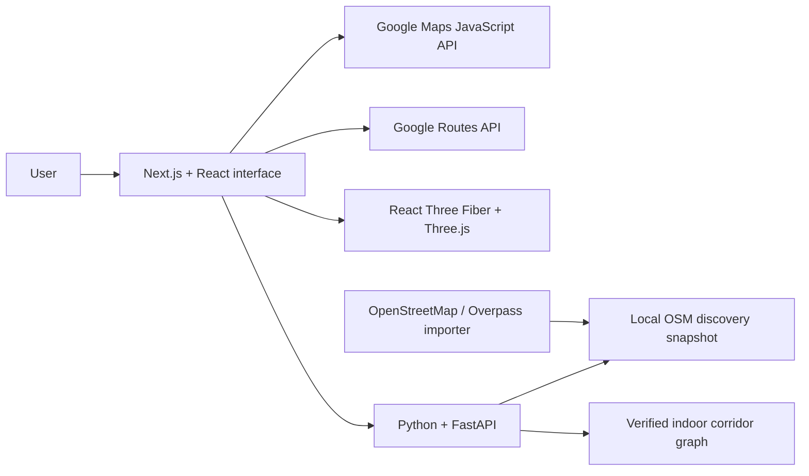

# PATHway Toronto

**An interactive mapping and route-planning platform for exploring downtown Toronto, with a foundation for floor-aware navigation through the PATH network.**

Built with **Next.js, React, TypeScript, Google Maps Platform, Three.js, Python, and FastAPI**.

[Features](#features) · [How it works](#how-it-works) · [Tech stack](#tech-stack) · [Run locally](#run-locally) · [API](#api-overview) · [Roadmap](#roadmap)

## Overview

Toronto's PATH connects transit stations, office towers, shops, and public spaces through a complex network of indoor walkways. Finding a particular destination can be difficult when routes cross buildings, entrances, and multiple levels.

**PATHway Toronto** explores how to make that experience more intuitive. It combines an interactive downtown map, searchable businesses and amenities, location-based route planning, and 3D visualization in a single application. The project also includes a dedicated backend for future indoor navigation based on verified corridor and floor data.

**Current scope:** Street-level walking directions and map exploration are functional with the required Google Maps APIs enabled. Accurate **underground PATH routing is a research/pilot feature** that requires surveyed, licensed indoor geometry before it can provide real directions.

## Features

### Interactive maps and location discovery

- **Map-first interface:** Explore downtown Toronto using the Google Maps JavaScript API, with an interface designed around search, destination selection, and route planning.
- **Searchable directory:** Discover community-mapped shops, cafés, restaurants, transit entrances, washrooms, elevators, escalators, and other amenities where OpenStreetMap data is available.
- **Category and level filters:** Narrow results by location type or available floor tags, including `-0.5`, `-1`, and `-2`. Unknown floors remain unknown rather than being assigned to a level.
- **Interactive markers:** Select map points, inspect available place details, and open source information for community-mapped locations.
- **Optional OSM import:** A one-time Overpass-based importer loads a local, attributed discovery dataset without embedding it in the repository.

### Point-to-point walking navigation

- **Flexible origins and destinations:** Enter named places or addresses, choose a community-mapped point of interest, or drop and drag start/end pins directly on the map.
- **Google-powered walking directions:** Calculate a provider-supplied walking route using the **Google Maps JavaScript Routes Library / Routes API**.
- **Visual route guidance:** Display the returned route geometry on the map, along with walking distance, estimated duration, and turn-by-turn steps when provided.
- **Interactive directions:** Highlight individual route steps and update a route after changing endpoints.
- **Location permission:** Optionally use the browser's approximate location as a starting point; this does not establish an indoor floor or precise PATH position.
- **Fallback navigation:** Open the same journey in Google Maps when an in-app route cannot be calculated.

### 3D exploration and visualization

- **Route-following flyover:** Replay a calculated *street walking route* in a stylized 3D scene, with playback and camera controls.
- **Community-mapped 3D context:** Render available OpenStreetMap building outlines as approximate visual context, not surveyed interiors.
- **Separate demonstration environments:** Explore the original schematic route and 3D corridor demos without confusing them with verified geographic data.

### Indoor routing architecture

- **Python/FastAPI routing service:** Exposes endpoints for indoor coverage, searchable directories, candidate exploration, floor-aware scenes, and route calculations.
- **Graph-based pathfinding:** Implements shortest-path search with route constraints for directionality, closures, accessibility flags, and floor changes.
- **Coordinate-based route planning:** Includes a tested mechanism to snap proposed pins to nearby reviewed corridor segments when valid indoor geometry exists.
- **Evidence-aware results:** Refuses to produce an indoor route when the underlying corridors or endpoints are unverified, rather than drawing a misleading shortcut.

## Navigation modes

| Mode | What it provides | Current availability |
| --- | --- | --- |
| **Street walking** | Real provider-calculated outdoor walking paths, map overlays, directions, and a 3D route flyover | **Functional** with Google Maps JavaScript API and Routes API access |
| **PATH atlas** | Searchable downtown points of interest, source links, category filters, level-aware discovery, and available OSM outlines | **Functional** after the optional OSM import |
| **Verified indoor PATH** | Routing over reviewed corridor geometry, including floor and access restrictions | **Framework implemented; awaiting verified indoor data** |
| **Synthetic / 3D demos** | Interactive prototypes for illustrating routing and 3D UI concepts | **Available as clearly labelled demonstrations** |

> **Navigation limitation:** The orange route is a Google-provided walking route, **not a verified underground PATH route**. The repository does not currently include a surveyed Toronto PATH corridor network. Indoor routing correctly returns `DATA_NOT_AVAILABLE` when route evidence is missing. Do not use the prototype for live underground or accessibility navigation.

## How it works



**Street route flow:** The user selects two locations → Google calculates a walking route → the frontend renders its geometry and instructions → the same returned geometry can drive the 3D flyover.

**Indoor route flow:** The user requests a PATH-only journey → FastAPI checks the reviewed network, floor levels, and route restrictions → it returns a supported path **only if** the necessary indoor data exists.

Community-mapped points of interest are **not automatically treated as walkable indoor corridors**.

## Tech stack

| Layer | Technologies | Role |
| --- | --- | --- |
| **Frontend** | Next.js 15, React 19, TypeScript, CSS | Responsive application, search, filters, and navigation UI |
| **Maps and directions** | Google Maps JavaScript API, Routes API | Geographic map, address-based walking routes, route geometry, and directions |
| **3D visualization** | Three.js, React Three Fiber, Drei | Interactive scenes, map context, and route flyover |
| **Backend** | Python, FastAPI, Pydantic | REST endpoints, spatial validation, and graph-based indoor routing |
| **Location data** | OpenStreetMap, Overpass API, local JSON | Community-mapped business/amenity discovery with source attribution |
| **Testing and tooling** | pytest, TypeScript compiler, Next.js build, npm audit, GitHub Actions | Backend tests, type checks, builds, and automated quality checks |

## Run locally

### Prerequisites

- Node.js **20+** (22 recommended) and npm
- Python **3.11+**
- A Google Cloud project with **Maps JavaScript API** and **Routes API** enabled, including billing and appropriate API-key restrictions, for live walking directions

### 1. Clone and configure

```bash
git clone https://github.com/brandondsa14-bot/pathway-toronto.git
cd pathway-toronto
cp frontend/.env.example frontend/.env.local
```

Add your restricted browser key to `frontend/.env.local`:

```dotenv
NEXT_PUBLIC_GOOGLE_MAPS_API_KEY=YOUR_RESTRICTED_GOOGLE_MAPS_KEY
```

Use **HTTP referrer** and **API** restrictions in Google Cloud. `NEXT_PUBLIC_*` values are visible to browsers, so never rely on the filename alone for security. The local `.env.local` file is gitignored; **do not commit real credentials**.

### 2. Start the backend

Open a terminal from the repository root:

```bash
cd backend
python3 -m venv .venv
source .venv/bin/activate
python -m pip install -r requirements.txt
uvicorn app.main:app --reload --port 8000
```

The local API is available at `http://localhost:8000`, with interactive docs at [`/docs`](http://localhost:8000/docs) when running in development mode.

### 3. Start the frontend

Open a **second terminal** from the repository root:

```bash
cd frontend
npm install
npm run dev -- -p 3000
```

Visit **http://localhost:3000**. Choose **Verified routes → Street walking** to request a real walking route, or **PATH atlas** to explore mapped locations.

### 4. Populate the optional community directory

From the repository root:

```bash
python3 tools/import_osm_path_candidates.py --fetch
```

This fetches the available downtown Toronto OSM records through Overpass and saves a local snapshot to `data/indoor/osm_candidates.json`. The generated file is **excluded from Git**, so a fresh clone must import its own data. Coverage and place details depend on community mapping and may change over time.

**Example:** A local import on **November 17, 2026** returned **5,440 downtown candidate locations**, with **1,213 heuristically tagged as possibly PATH-related**. These are discovery candidates, **not** 1,213 verified indoor destinations or routes.

## API overview

FastAPI separates public discovery data from verified indoor navigation.

| Endpoint | Purpose |
| --- | --- |
| `GET /health` | API status and verified indoor edge count |
| `GET /api/v2/indoor/explore` | Search/filter imported OSM points of interest |
| `GET /api/v2/indoor/catalog` | Search source-backed building directory listings |
| `GET /api/v2/indoor/coverage` | Inspect known locations and verified level coverage |
| `GET /api/v2/indoor/scene` | Retrieve reviewed spatial features for indoor map/3D rendering |
| `GET /api/v2/indoor/snap` | Check a proposed pin against reviewed indoor geometry |
| `GET /api/v2/indoor/route` | Calculate a route between verified indoor endpoints, if supported |
| `GET /api/v2/indoor/route/pins` | Route between coordinate/floor pairs on reviewed corridor segments, if supported |

**Design decision:** Google street directions are calculated in the browser using the Google Maps JavaScript Routes Library. They are not returned as or converted into verified indoor PATH routes.

## Testing

```bash
# Backend test suite
cd backend
source .venv/bin/activate
python -m pytest -q

# Frontend type-check and production build
cd ../frontend
npm run lint
npm run build
npm audit --omit=dev --audit-level=high

# Browser route-adapter regression checks
cd ..
node tools/test-street-route-adapter.cjs
```

The project includes backend tests for routing constraints, spatial validation, route instructions, and data integrity, as well as frontend type/build checks and a browser-route adapter test harness. GitHub Actions workflows are included for automated checks.

## Repository structure

```text
pathway-toronto/
├── frontend/
│   └── app/                 # Next.js UI, maps, route planner, and 3D scenes
├── backend/
│   ├── app/                 # FastAPI, routing, catalogs, and spatial validation
│   └── tests/               # Backend regression tests
├── data/
│   ├── geographic/          # Source references and separate demo graph
│   └── indoor/              # Reviewed-network inputs and local OSM data location
├── tools/                   # OSM importer, route tests, and release checks
├── docs/                    # Technical design, QA, data sourcing, and milestones
├── database/                # Database schema/migration groundwork
├── infrastructure/          # Local infrastructure configuration
└── .github/workflows/       # CI checks
```

## Roadmap

The next major milestone is a **fully validated indoor navigation pilot**, not simply a larger set of map markers:

1. Obtain permission to use accurate interior floor plans, corridor geometry, store entrances, and vertical connections for a defined PATH area.
2. Validate floor changes, accessibility constraints, closures, and directions against real-world routes.
3. Connect verified interior geometry to accurate 2D/3D scenes and expand coverage building by building.
4. Prepare a documented public deployment with data refresh, monitoring, API quotas, and field testing.

## Documentation and data sources

- [Route planner: design and limitations](docs/ROUTE_PLANNER_UPGRADE.md)
- [Navigation acceptance tests](docs/ROUTE_PLANNER_QA.md)
- [PATH Atlas: community-mapped discovery](docs/PATH_ATLAS_UPGRADE.md)
- [Data source and verification matrix](docs/PATH_ATLAS_SOURCE_MATRIX.md)
- [Indoor data rights and access](docs/SESSION_06_DATA_RIGHTS.md)
- [Release and deployment guidance](docs/SESSION_06_DEPLOY.md)

**Data attribution:** Community-mapped discovery data is sourced from [OpenStreetMap contributors](https://www.openstreetmap.org/copyright) under the ODbL. The [City of Toronto PATH information](https://www.toronto.ca/explore-enjoy/visitor-toronto/path-torontos-downtown-pedestrian-walkway/) and [Mappedin Toronto PATH reference](https://www.mappedin.com/map-gallery/path-map-toronto/) informed research and product requirements; their proprietary map geometry is not reproduced in this repository.

---

**PATHway Toronto is a full-stack navigation and spatial-data engineering project:** it demonstrates interactive mapping, external API integration, route planning, 3D visualization, and an evidence-based approach to building trustworthy indoor navigation.
